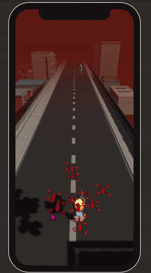

# Run-Gun

좀비가 등장하는 도로를 배경으로 한 세로 화면 슈팅 프로토타입입니다. 플레이어는 터치 입력으로 좌우 이동하며, 무기는 일정 간격으로 자동 발사합니다. 도로 구간이 화면 뒤로 지나가면 전방으로 옮겨 재사용하고, 전방 구간에 적을 배치합니다.

## 플레이 시연

## 기술 구성

**Unity 6000.1.8f1 · C# · URP 17.1.0 · Cinemachine 3.1.4 · Shader Graph**

| 기능 | 구현 | 코드 |
| --- | --- | --- |
| 터치 이동과 카메라 | Unity `Input.GetTouch`에서 누르는 동안의 화면 좌표를 전달합니다. 플레이어 화면 좌표와의 차이로 좌우 이동 방향을 구하고 X축 이동 범위를 제한합니다. Cinemachine은 플레이어의 좌우 변위를 줄여 반영하는 별도 타깃을 따라갑니다. | [InputManager](Assets/Scripts/Managers/InputManager.cs) · [PlayerController](Assets/Scripts/Controllers/PlayerController.cs) · [CameraTargetController](Assets/Scripts/Controllers/CameraTargetController.cs) |
| 무기 데이터와 자동 사격 | `GunInfo` ScriptableObject에 총기별 탄환 프리팹, 발사 방향, 초기 속도, 모델의 크기와 위치 보정값을 둡니다. `Gun`은 고정 주기로 발사하고 발사 애니메이션과 파티클을 재생합니다. `OnAnimatorIK`가 총기 소켓에 양손의 위치와 회전을 맞춥니다. | [총기 스크립트와 에셋](Assets/Scripts/Contents/Gun) · [PlayerController](Assets/Scripts/Controllers/PlayerController.cs) |
| 스크롤을 반영한 탄환 판정 | 탄환 첫 갱신에서 탄환 속도 벡터에서 스크롤 속도 벡터를 빼 상대 속도를 구합니다. `Monster` 레이어에 Raycast를 수행하고, 적중 지점까지의 거리를 상대 속력으로 나눈 시간만큼 기다린 뒤 피해와 적중 이펙트를 처리합니다. | [Bullet](Assets/Scripts/Contents/Gun/Bullet.cs) |
| 맵 재사용과 적 스폰 | 스크롤이 진행되면 지나간 번들을 전방으로 옮깁니다. 번들 배치 및 재배치 때 발행한 이벤트를 `MonsterManager`가 받아 마지막 번들 기준으로 기본 몬스터 종류와 등장 수(1~2마리)를 정합니다. | [ScrollSystem](Assets/Scripts/Contents/ScrollSystem.cs) · [BundleLoopSystem](Assets/Scripts/Contents/BundleLoopSystem.cs) · [MonsterManager](Assets/Scripts/Managers/MonsterManager.cs) |
| 몬스터 상태와 사망 연출 | 기본 몬스터의 대기·피격·사망 상태를 Animator 전환과 연결합니다. 사망 시 코루틴으로 넉백을 적용하고, 머티리얼 인스턴스의 `_DissolveAmount`를 갱신해 개별적으로 디졸브를 진행합니다. | [BaseMonster](Assets/Scripts/Monsters/BaseMonster.cs) · [BasicMonster](Assets/Scripts/Monsters/BasicMonster.cs) · [Dissolve Shader Graph](Assets/Resources/DissolveShader.shadergraph) |
| 오브젝트 풀과 이벤트 | `ResourceManager`가 `Resources`에서 프리팹을 읽고, `Poolable`이 붙은 오브젝트의 생성과 반환을 스택 기반 풀에 위임합니다. 기본 몬스터 프리팹 3종에 풀이 적용되어 있습니다. 스폰 이벤트는 맵과 몬스터 로직을 연결합니다. | [PoolManager](Assets/Scripts/Managers/PoolManager.cs) · [ResourceManager](Assets/Scripts/Managers/ResoureManager.cs) · [EventManager](Assets/Scripts/Managers/EventManager.cs) |

## 에디터에서 열기

1. 저장소 루트 폴더를 Unity Hub에 추가하고 **6000.1.8f1**로 엽니다.
2. [Assets/Scenes/MJ.unity](Assets/Scenes/MJ.unity)를 열고 Play를 누릅니다. 터치가 전달되는 환경에서 화면을 누른 채 움직이면 캐릭터가 좌우로 이동합니다.

현재 [빌드 설정](ProjectSettings/EditorBuildSettings.asset)의 씬 목록은 비어 있습니다. 엘리트·중간 보스·최종 보스 스크립트에는 클래스 틀이 있으며, 아이템 상자는 트리거와 월드 공간 텍스트까지 연결된 상태입니다.
